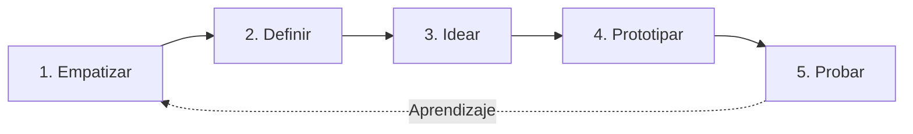

# Trabajo Colaborativo, Visión Compartida y Design Thinking

> [!NOTE]
> **Enfoque de Ingeniería y Liderazgo Técnico (Big Tech Mindset)**  
> El riesgo más caro de un producto no es técnico: es la **brecha semántica** entre lo que el cliente pide y lo que el equipo interpreta. En Agile, fallar está bien siempre que el fallo sea rápido, barato y recuperable. Las técnicas de este documento existen para descubrir esas desconexiones al menor costo posible, antes de escribir código.

---

## Herramientas para Establecer una Visión Compartida

| Herramienta | Cómo ayuda a compartir la visión |
| :--- | :--- |
| **Charter ágil** | Alinea el porqué, los objetivos y los límites del proyecto. Ver [Gestión de Integración](../02-project-planning/agile-integration-management.md). |
| **Definition of Done** | Elimina la ambigüedad sobre cuándo algo está terminado. Ver [Historias de Usuario](user-stories-discovery.md). |
| **Talleres (workshops)** | Construyen el entendimiento en grupo en lugar de transmitirlo por documentos. |
| **Wireframes y prototipos** | Hacen tangible la solución para validarla antes de invertir en desarrollo. |
| **Personas** | Dan un rostro concreto al usuario para el que se diseña. |

---

## Comunicación del Equipo

* **Cara a cara (F2F):** es el canal con mayor *ancho de banda*; transfiere la mayor cantidad de información por unidad de tiempo y permite interacción en tiempo real, a diferencia de los canales estáticos como los informes escritos.
* **Bidireccional:** los trabajadores del conocimiento suelen saber más de su trabajo que quienes los dirigen, por lo que la comunicación no puede ser solo descendente; el líder pregunta y escucha.

```text
  Efectividad
     Alta │                                   ● Cara a cara con pizarra
          │                          ● Videollamada
          │                 ● Llamada de voz
          │        ● Chat / correo
     Baja │ ● Documento escrito
          └────────────────────────────────────────────────
            Baja                Riqueza del canal            Alta
```

Los radiadores de información que sostienen esta comunicación se detallan en [Stakeholders y Comunicación](../02-project-planning/stakeholders-comm.md).

---

## Talleres (Workshops)

Un taller es una reunión en la que los participantes **realizan el trabajo**, a diferencia de una reunión informativa. Las retrospectivas, las sesiones de estimación y las de planificación son talleres.

Todo taller debe definir de forma visible:

| Elemento | Taller de creación de historias | Taller de retrospectiva |
| :--- | :--- | :--- |
| **Objetivo** | Obtener historias de usuario priorizables. | Acordar mejoras concretas del proceso. |
| **Pasos** | Presentar personas, mapear el flujo, redactar historias. | Recoger datos, generar ideas, decidir acciones. |
| **Criterio de éxito** | Historias que cumplen INVEST. | Una a tres acciones con responsable. |

**Consejos de facilitación:**

* Los grupos diversos generan un abanico de opciones más amplio que unos pocos expertos.
* Para evitar que las personas dominantes monopolicen la discusión, usar turnos *round-robin* o generación de ideas en notas adhesivas.

---

## Lluvia de Ideas (Brainstorming)

Técnica para generar rápidamente muchas ideas sobre un problema. En proyectos ágiles se usa para identificar roles de usuario, características del MVP, riesgos y soluciones a problemas de una retrospectiva.

### Métodos

| Método | Cómo funciona | Ventaja | Limitación |
| :--- | :--- | :--- | :--- |
| **Escritura silenciosa (Quiet Writing)** | Cada persona genera ideas individualmente de 5 a 7 minutos antes de compartir. | Minimiza la influencia de los pares. | Las ideas no se construyen unas sobre otras al inicio. |
| **Round-Robin** | Se pasa un token; quien lo recibe aporta una idea. | Las ideas se construyen entre sí y todos participan. | Requiere comodidad para exponer ideas ante el grupo. |
| **Libre (Free-for-All)** | Las ideas se dicen espontáneamente. | Muy colaborativo y rápido. | Solo funciona en un entorno de apoyo; los más callados pueden no ser escuchados. |

### Proceso recomendado

1. **Preparar:** reunir un equipo multidisciplinario que conozca el problema.
2. **Fijar reglas:** no criticar ideas, participación de todos, cantidad sobre calidad.
3. **Definir el objetivo:** presentar con claridad el problema o la meta de la sesión.
4. **Generar:** aportar ideas sin filtrar; usar preguntas abiertas para estimular.
5. **Registrar:** capturar todas las ideas en una pizarra o herramienta colaborativa.
6. **Organizar y priorizar:** agrupar y votar según viabilidad, impacto y valor.
7. **Convertir en acciones:** definir pasos, responsables y plazos, y dar seguimiento.

---

## Juegos de Colaboración (Innovation Games)

Técnicas de taller facilitadas para comprender problemas complejos o ambiguos y llegar a consensos.

| Juego | Propósito | Dinámica |
| :--- | :--- | :--- |
| **Recordar el Futuro** | Fijar la visión y obtener requisitos. | El equipo imagina que el producto ya se lanzó con éxito y describe "qué ocurrió" para lograrlo. |
| **Podar el Árbol del Producto** | Reunir y dar forma a los requisitos. | El tronco es lo existente; las ramas son áreas funcionales; las hojas son nuevas características que se colocan (cerca o lejos del tronco según su prioridad). |
| **Lancha Rápida (Speedboat)** | Identificar amenazas y oportunidades. | Las anclas son lo que frena al producto; el viento es lo que lo impulsa. Alimenta el [registro de riesgos](../02-project-planning/risk-management.md). |

---

## Design Thinking

Metodología centrada en el usuario: las soluciones más efectivas surgen cuando se comprenden a fondo las necesidades y deseos de las personas para las que se diseña. Fomenta la colaboración interdisciplinaria y el trabajo iterativo.

La innovación ocurre en la intersección de tres elementos:

```text
   Deseos de los clientes        Nuestras capacidades        Viabilidad del negocio
      (Deseabilidad)                (Factibilidad)               (Viabilidad)
             └──────────────────────────┼──────────────────────────┘
                                   INNOVACIÓN
```

### Las 5 Fases



1. **Empatizar:** entender a los usuarios mediante entrevistas, observación y preguntas.
2. **Definir:** con los datos recogidos, delimitar el problema concreto a resolver.
3. **Idear:** generar múltiples soluciones posibles sin restringirse.
4. **Prototipar:** materializar las mejores ideas en bocetos, maquetas o wireframes.
5. **Probar:** poner el prototipo frente a usuarios y recoger comentarios para mejorarlo.

### Caja de Herramientas por Fase

| Fase | Herramienta | Qué contiene |
| :--- | :--- | :--- |
| Empatizar | **Stakeholder Onion Map** | Interesados dispuestos en capas concéntricas según su cercanía al núcleo del producto. Complementa la [Matriz de Poder / Interés](../02-project-planning/stakeholders-comm.md). |
| Empatizar | **Personas** | Cuatro cuadrantes: datos demográficos; escenario y contexto; necesidades, motivaciones y creencias; objetivos y metas. |
| Empatizar | **Mapa de Empatía** | ¿Qué piensa y siente? ¿Qué oye? ¿Qué ve? ¿Qué dice y hace? Más sus esfuerzos (obstáculos) y resultados (beneficios esperados). |
| Empatizar / Definir | **Journey Map** | Perfil del cliente, puntos de contacto, acciones, pensamientos y emociones (altos y bajos) en cada paso. |
| Definir | **Brief de Diseño** | Descripción del proyecto, alcance, restricciones, usuarios objetivo, preguntas de exploración, resultados esperados y métricas de éxito. |
| Idear | **Canvas de Propuesta de Valor** | Lado del cliente: trabajos, frustraciones y alegrías. Lado del producto: productos y servicios, aliviadores de frustraciones y creadores de alegrías. |
| Probar | **Matriz de Feedback** | Lo que agrada al usuario; críticas constructivas; preguntas que surgieron; nuevas ideas. |

### Delimitar bien el Problema

La sección más importante del brief es la delimitación del problema. Debe responder: ¿cuál es el problema?, ¿a quién afecta?, ¿cuáles son sus causas y consecuencias?, ¿qué se ha intentado hasta ahora?

* **Específico:** no "el sitio web no funciona", sino "el sitio es lento y difícil de usar, lo que frustra a los usuarios y provoca abandonos".
* **Objetivo:** presentar hechos, no opiniones.
* **Conciso y en lenguaje sencillo:** comprensible para cualquier interesado, sin jerga.

### ¿Cuándo Usar Design Thinking?

| Situación | Preguntas a plantear |
| :--- | :--- |
| Desarrollo de un nuevo producto | ¿Qué necesidades no satisfechas tienen los usuarios potenciales? |
| Mejora de la experiencia en un servicio existente | ¿Cuáles son los puntos de dolor actuales? |
| Optimización de un proceso interno | ¿Dónde están los cuellos de botella? ¿Cómo simplificarlo? |

Una vez validado el problema y la solución, el siguiente paso es definir el MVP con [Lean Startup y Lean Inception](lean-startup-inception.md).
