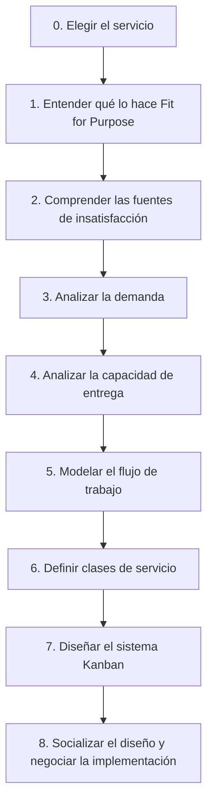

# El Método Kanban: Servicios, STATIK y Scrumban

> [!NOTE]
> **Enfoque de Ingeniería y Liderazgo Técnico (Big Tech Mindset)**  
> Kanban no busca que empieces más trabajo; busca que **termines** más trabajo (*stop starting, start finishing*). Un tablero con columnas es solo la superficie: el método completo implica entender la demanda, medir la capacidad real y diseñar políticas explícitas. Este documento profundiza la introducción de [Scrum y Kanban](scrum-and-kanban.md).

---

## Push vs. Pull

*Kanban* significa "tarjeta visual" (*kan* = visual, *ban* = tarjeta). Nació en Toyota a finales de los años 40 dentro del sistema *Just-in-Time*: producir solo lo necesario, cuando es necesario y en la cantidad necesaria.

| | Sistema Push | Sistema Pull |
| :--- | :--- | :--- |
| **Regla** | Cada etapa empuja su trabajo a la siguiente apenas lo termina. | Cada etapa *jala* trabajo de la anterior solo cuando tiene capacidad libre. |
| **Límites** | No existen; todos trabajan lo más rápido posible. | Límite WIP explícito por etapa. |
| **Efecto** | Se acumulan colas y aparecen cuellos de botella. | El flujo se mantiene estable y los bloqueos se hacen visibles. |

*Ejemplo (cocina de restaurante):* en *push* se aceptan todos los pedidos y la cocina se satura; en *pull* la cocina trabaja con WIP = 2 pedidos y avisa cuando está libre para recibir el siguiente.

---

## Valores y Principios

**Valores:** el método está guiado por el respeto a todas las personas que contribuyen al trabajo.

| Valores | Significado |
| :--- | :--- |
| **Equilibrio y flujo** | Ritmo de entrega considerable y sostenible. |
| **Respeto y liderazgo** | Todas las personas tienen voz; el liderazgo se ejerce en todos los niveles. |
| **Colaboración y foco en el cliente** | El equipo afronta los retos en conjunto para entregar justo a tiempo. |
| **Acuerdo y entendimiento** | Claridad compartida sobre las metas y la estrategia. |
| **Transparencia** | Se inspecciona y se reconocen abiertamente las oportunidades de mejora. |

**Principios de gestión del cambio**

1. Comenzar con lo que se hace actualmente, respetando roles, funciones y responsabilidades.
2. Acordar la búsqueda de mejora mediante el cambio evolutivo.
3. Fomentar actos de liderazgo en todos los niveles.

**Principios de entrega de servicios**

1. Entender y centrarse en las necesidades y expectativas del cliente.
2. Gestionar el trabajo y dejar que las personas se autoorganicen a su alrededor.
3. Evolucionar las políticas para mejorar los resultados del cliente y del negocio.

> **Fit for Purpose (adecuado al propósito):** tu auto se pincha camino a una reunión. El seguro lo arregla gratis en 1 hora; el taller de enfrente cobra y tarda 15 minutos. Probablemente elijas el taller. El seguro no es "peor": simplemente no se ajusta a tu necesidad *en ese momento*. Un servicio es bueno cuando cumple la expectativa del cliente en su contexto.

---

## Las 6 Prácticas Generales

Las cuatro primeras (visualizar, limitar el WIP, gestionar el flujo, políticas explícitas) se explican en [Scrum y Kanban](scrum-and-kanban.md). El método completo añade dos:

5. **Implementar ciclos de retroalimentación (cadencias):** reuniones cíclicas que dirigen la evolución del sistema.
6. **Mejorar colaborativamente, evolucionar experimentalmente:** aplicar el método científico; un equipo con comprensión compartida del flujo acuerda mejores cambios.

### Cadencias de Kanban

Implementar todas es complejo e involucra a muchos actores; se recomienda empezar por las que están al alcance del equipo y luego ampliar a la organización.

| Cadencia | Nivel | Frecuencia típica | Propósito |
| :--- | :--- | :--- | :--- |
| **Reunión Kanban** | Equipo | Diaria | Revisar el tablero y desbloquear el flujo. |
| **Reposición (Replenishment)** | Equipo | Semanal o bajo demanda (20–30 min) | Seleccionar los nuevos ítems que entran al sistema. |
| **Planificación de la Entrega** | Equipo | Por entrega | Coordinar qué se entrega al cliente y cuándo. |
| **Revisión de la Entrega del Servicio** | Servicio | Quincenal | Comparar el desempeño con las expectativas del cliente. |
| **Revisión de Operaciones** | Organización | Mensual | Revisar el equilibrio entre servicios interdependientes. |
| **Revisión de Riesgos** | Organización | Mensual | Analizar los riesgos y bloqueos de la entrega. |
| **Revisión de Estrategia** | Organización | Trimestral | Ajustar la dirección según el mercado. |

**Reposición:** como el sistema es *pull*, solo se introducen ítems nuevos si hay un hueco y respetando el límite WIP.

### Roles

Kanban es el método "empieza donde estés": nadie recibe un cargo nuevo y no hay roles obligatorios. Cuando surgen, suelen ser dos:

* **Gestor de Peticiones de Servicio (Service Request Manager):** entiende las necesidades del cliente y facilita la selección y el orden de los ítems en la reunión de reposición. Suele asumirlo el Product Owner.
* **Gestor de la Entrega (Service Delivery Manager):** responsable del flujo; facilita la reunión Kanban y la planificación de la entrega.

---

## Kanban como Entrega de Servicios

Un **servicio** es el conjunto de actividades que responde a la necesidad de un solicitante hasta que este reconoce la entrega conforme. En software: desarrollo de funcionalidades, resolución de incidencias, pruebas de calidad, despliegue, mantenimiento o soporte al usuario.

**Lente de Kanban:** la organización es una **red de servicios interdependientes**, cada uno con políticas que determinan su comportamiento. No es útil mejorar un solo nodo; lo útil es mejorar la conexión entre todos.

### Clases de Servicio y Costo de la Demora

No todos los ítems necesitan el mismo trato. Las clases de servicio los clasifican según su **costo de la demora** (*Cost of Delay*): ¿cuánto me costaría que este ítem se retrase?

| Clase | Costo de la demora | Política típica |
| :--- | :--- | :--- |
| **Expedito** | Inmediato y muy alto (ej. caída de producción). | Se atiende ya, puede saltarse los límites WIP; máximo 1 a la vez; transparencia total. |
| **Fecha fija** | Se dispara al pasar una fecha (ej. obligación regulatoria). | Se planifica para llegar a tiempo; se monitorea su riesgo. |
| **Estándar** | Crece de forma gradual. | Cola FIFO con un SLA probabilístico (ej. "hasta 30 días, 98 % a tiempo"). |
| **Intangible** | Bajo hoy, alto en el futuro (ej. deuda técnica). | Se reserva una parte de la capacidad para no postergarlo indefinidamente. |

Ante una petición "urgente", preguntar siempre *por qué* se considera expedita y cuál es su costo de demora real.

### Beneficios de Limitar el WIP

* Disminuye el Lead Time (ver [Ley de Little](agile-metrics.md#ley-de-little)).
* Hace visibles los límites reales del equipo (habilidades y capacidad).
* Reduce tiempos muertos: quien queda libre ayuda a resolver bloqueos en lugar de iniciar algo nuevo.
* Protege un ritmo sostenible y la calidad.

### Columnas Frecuentes de un Tablero de Software

Además de *Por hacer / En progreso / Hecho*, un flujo real suele necesitar algunas de estas columnas:

| Zona | Columnas posibles |
| :--- | :--- |
| **Upstream (preparación)** | Backlog, Refinamiento, Listo para desarrollo. |
| **Construcción** | En progreso, Revisión de código, Bloqueado. |
| **Validación** | Pruebas / QA, Preproducción (Staging), UAT. |
| **Entrega** | Listo para despliegue, Despliegue, Verificación en producción, Hecho. |
| **Carriles especiales** | Hotfix (expedito), Mantenimiento. |

Se añade una columna solo si representa un estado real del trabajo donde este puede esperar.

---

## STATIK: Cómo Diseñar un Sistema Kanban

**STATIK** (*Systems Thinking Approach to Introducing Kanban*) es un método basado en el pensamiento sistémico para diseñar un sistema Kanban adaptado al contexto. Se aplica en grupo, con todas las personas que participan en el servicio. El **pensamiento sistémico** implica que cada solución considere las características del sistema completo, no solo de una parte.

### STATIK vs. Tablero Kanban

| Aspecto | STATIK | Tablero Kanban |
| :--- | :--- | :--- |
| **Qué es** | Método de diseño. | Herramienta visual resultante. |
| **Propósito** | Entender el sistema y definir políticas, WIP, clases de servicio y métricas. | Hacer visible el flujo día a día. |
| **Cuándo** | Antes de construir o rehacer el tablero; se revisita si cambian las condiciones. | Uso continuo. |
| **Alcance** | Sistémico: clientes, upstream, downstream, dependencias. | Operacional: ítems dentro del proceso definido. |
| **Análogo en Scrum** | Acordar la DoD, la DoR y los eventos del Sprint. | El Sprint Backlog que se actualiza a diario. |

### Los Pasos



| Paso | Qué se hace | Preguntas guía |
| :--- | :--- | :--- |
| **0. Elegir el servicio** | Delimitar el servicio a mejorar. Un servicio abarca varias columnas del tablero. | ¿Qué servicio conocemos bien y tiene datos? |
| **1. Fit for Purpose** | Listar subservicios y clientes directos, mapear la red de servicios y definir el criterio de adecuación. | ¿Qué necesidad satisfacemos y cómo se mide? |
| **2. Fuentes de insatisfacción** | Recoger quejas externas (clientes) e internas (equipo). | ¿De qué se queja el cliente? ¿Qué frustra al equipo? |
| **3. Demanda** | Identificar quién solicita, qué tipos de trabajo, con qué patrón y urgencia. | ¿Cuántas al mes? ¿Hay estacionalidad? ¿Qué es urgente? |
| **4. Capacidad** | Medir throughput, lead time frente al SLA, calidad y dedicación real del personal. | ¿Cuánto entregamos y en cuánto tiempo? |
| **5. Flujo** | Modelar la sucesión de estados por tipo de trabajo, con condición de entrada y de satisfacción en cada paso. | ¿Qué pasos sigue una solicitud de inicio a fin? |
| **6. Clases de servicio** | Asignar políticas según el costo de la demora. | ¿Qué sería expedito? ¿Qué sería estándar? |
| **7. Diseño** | Definir el tablero y las tarjetas, estados, límites WIP, política de reposición, puntos de compromiso, métricas y cadencias. | ¿Qué columnas y límites tendrá? |
| **8. Socializar** | Presentar el diseño a los interesados y acordar su adopción. | ¿Qué acuerdos necesitamos con clientes y áreas vecinas? |

### Fuentes de Insatisfacción

| Externas (del cliente) | Internas (del equipo) |
| :--- | :--- |
| **Tiempo:** "se demoran mucho". | **Muri (sobrecarga):** "trabajo los fines de semana". |
| **Calidad:** "me entregan las cosas incompletas". | **Mura (variabilidad):** "me cambian la prioridad y dejo el trabajo a medias". |
| **Costo:** "se exceden las horas contratadas". | **Muda (desperdicio):** "las áreas de las que dependo tardan en responder". |
| **Predictibilidad:** "el tiempo de entrega varía mucho". | **Falta de coordinación:** "no tenemos claro qué hay que hacer". |

*Muri* y *Mura* completan, junto con *Muda*, las "3 M" de Lean. Cada insatisfacción externa suele tener una causa interna: emparejarlas orienta el diseño del sistema.

### Ejemplo de Análisis de Demanda y Capacidad

| Tipo de trabajo | Solicitante | Demanda | Clase | Capacidad actual |
| :--- | :--- | :--- | :--- | :--- |
| Petición de cambio | Product Manager | 10–12 al mes, en ráfagas estacionales | Estándar | 5–6 al mes |
| Cambio de texto en producción | Áreas internas | 20–25 al mes | Expedito (SLA 48 h) | Todas en el mes |

La petición de cambio recibe el doble de lo que el equipo puede entregar: la cola crecerá sin importar cómo se dibuje el tablero. Ese es el tipo de hallazgo que STATIK revela antes de diseñar.

---

## Scrumban

Combina la estructura de Scrum con el flujo de Kanban. Es útil para equipos Scrum cuyo trabajo incluye mucha demanda no planificable, o como transición entre ambos marcos.

| Toma de Scrum | Toma de Kanban |
| :--- | :--- |
| Equipo multifuncional y roles. | Flujo *pull* y límites WIP por columna. |
| Reunión diaria y retrospectiva. | Planificación bajo demanda, no por Sprint. |
| Repriorización constante con el cliente. | Métricas de flujo (Lead Time, Cycle Time). |

```text
| TO DO | PLAN | DEVELOP (4) | TEST (2) | DEPLOY | DONE |
```

Dividir "En progreso" en varias columnas con su propio límite es lo que permite ver dónde se forma el cuello de botella.

**Reunión diaria (frente al tablero):**

1. ¿Alguien está trabajando en algo que no está en el tablero?
2. ¿Qué necesitamos hacer para terminar lo pendiente?
3. ¿Hay algún cuello de botella u otro impedimento en el flujo?

**Retrospectiva semanal:**

* ¿Hay trabajo en progreso oculto que no esté reflejado en el tablero?
* ¿Cada tarea tiene el nivel correcto de detalle?
* ¿Hay colas o frenos en el flujo que el tablero no muestra?
* ¿Cómo nos sentimos como equipo?

---

## Caso Práctico: Cuello de Botella con la Teoría de Restricciones (TOC)

Un equipo entrega solo 2 funcionalidades por semana aunque casi todas sus etapas pueden procesar 5 o 6. No se puede contratar personal.

| Etapa | Capacidad (func./semana) | Cola actual |
| :--- | :---: | :---: |
| Análisis | 6 | 1 |
| Desarrollo | 6 | 1 |
| Revisión legal | 5 | 1 |
| QA | 2 | 6 |
| Despliegue | 5 | 0 |

Datos adicionales: WIP total de 12 (9 en cola) y el 15 % de lo que sale de QA vuelve a Desarrollo.

**Los 5 pasos de enfoque de TOC:**

1. **Identificar la restricción:** QA. Tiene la menor capacidad (2/semana) y la mayor cola (6). El sistema entrega exactamente lo que su restricción permite. Por la Ley de Little, el Lead Time medio es 12 ÷ 2 = **6 semanas**.
2. **Explotar (sin gastar):** que QA no pierda tiempo. El 15 % de retrabajo consume capacidad del recurso más escaso; reforzar la DoD de Desarrollo (pruebas unitarias, revisión de pares) para que a QA solo le llegue trabajo listo, y protegerlo de interrupciones.
3. **Subordinar:** las demás etapas trabajan al ritmo de QA. Desarrollo no inicia trabajo nuevo si la cola de QA llegó a su límite (ej. WIP de la cola = 3); la capacidad libre se usa para ayudar a QA o reducir defectos.
4. **Elevar:** si lo anterior no alcanza, aplicar una mejora permanente sin contratar: automatizar las pruebas de regresión y capacitar a desarrolladores para ejecutar pruebas (habilidades en T).
5. **Repetir:** si QA sube a 4/semana, **sigue siendo la restricción** (4 < 5). Recién al superar 5/semana la restricción se traslada a Revisión legal y Despliegue (ambas en 5), y se vería porque la cola empezaría a acumularse delante de ellas. La restricción siempre se confirma con datos, no por intuición.

> **Lección:** optimizar cualquier etapa que no sea la restricción (por ejemplo, hacer más rápido a Desarrollo) no aumenta la entrega; solo agranda la cola frente a QA.
