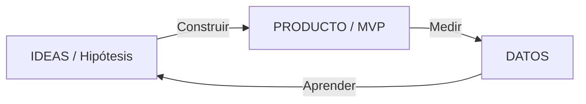

# Lean Startup y Lean Inception: Construir el Producto Correcto

> [!NOTE]
> **Enfoque de Ingeniería y Liderazgo Técnico (Big Tech Mindset)**  
> Ejecutar con eficacia un mal plan es "lograr el fracaso": de nada sirve entregar a tiempo, dentro del presupuesto y con alta calidad algo que a nadie le interesa. Antes de optimizar *cómo* construimos, hay que validar *qué* construir.

---

## Lean Startup

### Origen y Definición

* **Steve Blank** observó un patrón común en las startups de Silicon Valley y lo formalizó como *Customer Development* en *The Four Steps to the Epiphany*.
* **Eric Ries**, alumno de Blank, aterrizó el método como **Lean Startup**: un enfoque científico para crear productos bajo incertidumbre, invirtiendo los mínimos recursos para obtener la máxima información.

Una startup **no** es una versión en miniatura de una empresa establecida:

| | Empresa establecida | Startup |
| :--- | :--- | :--- |
| **Naturaleza** | Ejecuta un modelo de negocio conocido. | Organización temporal que *busca* un modelo de negocio escalable y repetible. |
| **Instrumento** | Plan de negocio y gestión tradicional. | Experimentos e hipótesis. |
| **Riesgo principal** | Ejecutar mal. | Construir algo que nadie quiere. |

Por eso fallan las startups que aplican teorías de management tradicional (hechas para organizaciones establecidas) o el extremo opuesto del "simplemente hazlo".

### Los 5 Principios (Eric Ries)

1. **Los emprendedores están en todas partes:** aplica a cualquier equipo que cree productos bajo incertidumbre, también dentro de corporaciones.
2. **El emprendimiento es gestión:** requiere una gestión adaptada a su contexto de incertidumbre.
3. **Aprendizaje validado:** el progreso se mide por lo aprendido con evidencia de clientes reales, no por lo construido.
4. **Construir – Medir – Aprender:** el ciclo fundamental de retroalimentación.
5. **Contabilidad de la innovación:** medir el progreso con métricas accionables, no con métricas de vanidad.

### El Ciclo Construir – Medir – Aprender



El objetivo es **minimizar el tiempo total** de una vuelta completa al ciclo.

1. **Construir:** trasladar la idea a un MVP con las características que el equipo considera prioritarias, suficiente para estudiar la reacción de los clientes.
2. **Medir:** recabar datos sobre el uso del producto y la respuesta de los consumidores.
3. **Aprender:** con los resultados, decidir entre **perseverar** (la hipótesis se confirma, se sigue optimizando) o **pivotar** (cambiar un elemento fundamental de la estrategia y plantear una nueva hipótesis).

### Hipótesis

Plantilla para formular la hipótesis a validar:

> *Creo que **[usuario]** tiene el problema **[X]** y pagaría por **[Y]**.*

### Métricas Pirata (AARRR)

| Métrica | Pregunta que responde |
| :--- | :--- |
| **Adquisición** | ¿Cuántos usuarios llegan? |
| **Activación** | ¿Tienen una buena primera experiencia y lo usan? |
| **Retención** | ¿Regresan? |
| **Ingresos (Revenue)** | ¿Pagan? |
| **Recomendación (Referral)** | ¿Lo recomiendan a otros? |

### El MVP como Instrumento de Aprendizaje

En Lean Startup, el MVP es la versión del producto que permite recoger la **máxima cantidad de aprendizaje validado con el mínimo esfuerzo**. Se ubica entre el producto pobre que nadie quiere usar y el producto soñado: *mínimo* y a la vez *viable*. Esta visión complementa el enfoque incremental de Kniberg descrito en [Alcance y EDT](../02-project-planning/scope-and-wbs.md).

**Objetivos del MVP:**

* Evitar la creación de un producto inútil.
* Comprobar las hipótesis con evidencia y con anticipación.
* Maximizar el aprendizaje sobre los clientes con menos recursos.

**Caso Dropbox:** antes de invertir en la infraestructura de sincronización de archivos en la nube, el equipo publicó un video que mostraba cómo funcionaría el producto. La respuesta del público validó la demanda sin haber construido el servicio.

### Caso Práctico: "Muchos lo usan, pero nadie paga"

Lectura con AARRR: adquisición, activación y retención son saludables; el problema está en ingresos. La hipótesis de *problema* se confirma (los usuarios lo necesitan), pero la hipótesis de *disposición a pagar* se refuta. No hay que rehacer el producto, sino pivotar el modelo de captura de valor y formular una nueva hipótesis, por ejemplo: *"Creo que las empresas, y no los usuarios individuales, pagarían por reportes consolidados"*. Se construye el mínimo experimento para probarla y se vuelve a medir.

---

## Agile Inception

Conjunto de actividades que permiten al equipo **comenzar** el desarrollo de forma coherente, estableciendo un propósito y expectativas comunes entre el equipo y los interesados. Usa la inteligencia colectiva para que todos arranquen mirando en la misma dirección.

| Etapa | Pregunta | Qué se define |
| :--- | :--- | :--- |
| **1. ¿Por qué?** | ¿Por qué estamos aquí? | Las razones del proyecto. |
| | Elevator pitch | Descripción convincente del producto en 30 segundos. |
| | ¿Cómo se verá? | Qué tendrá para que el cliente lo desee al verlo. |
| | ¿Qué no es? | Todo aquello que el producto no es. |
| | Interdependencias | Las partes que se necesitarán para el desarrollo. |
| **2. ¿Cómo?** | Idear la solución | El modo de alcanzar la meta. |
| | Posibles problemas | Ponerse en el peor de los casos para identificar riesgos. |
| | Previsión temporal | Cuánto durará el desarrollo, con realismo. |
| | Ser claros | Qué es inamovible (ej. presupuesto o calidad). |

**Plantilla de elevator pitch:** qué es, para quién, y por qué lo necesita. Si no cabe en 30 segundos cronometrados, la visión todavía no está clara.

---

## Lean Inception

Es la versión *lean* del inicio, propuesta por Paulo Caroli. Se llama así por dos razones:

1. **Es más corta:** elimina todo lo que no trata sobre el producto (arquitectura, plan de proyecto, etc.).
2. **Su resultado es la comprensión del MVP**, concepto central de Lean Startup.

### Cuándo Usarla (y Cuándo No)

* **Sí:** cuando el equipo necesita desarrollar un MVP de forma iterativa, o cuando trabaja en **desarrollo de doble vía** (*dual-track*: descubrimiento continuo y entrega continua en paralelo) y el descubrimiento ha generado suficiente información para decidir qué construir.
* **No sustituye:** las sesiones de ideación, la investigación de clientes, la revisión de arquitectura ni el análisis competitivo.

### Actividades del Taller

| # | Actividad | Resultado |
| :---: | :--- | :--- |
| 1 | **Visión del producto** | Para quién se construye, qué problema resuelve y cuál es su valor. Sin esto, cada persona imagina un producto distinto. |
| 2 | **Es / No es – Hace / No hace** | Foco y claridad: incluye lo que el producto nunca tendrá o no tendrá por ahora. |
| 3 | **Objetivos del producto** | Objetivos de negocio compartidos por todos los participantes. |
| 4 | **Personas** | Un perfil por tipo de usuario, con sus necesidades e información relevante. |
| 5 | **Jornadas del usuario** | Recorrido de cada persona para alcanzar su objetivo. |
| 6 | **Lluvia de funcionalidades** | Características que soportan cada paso de las jornadas. |
| 7 | **Revisión técnica, de UX y de negocio** | Esfuerzo, valor y nivel de incertidumbre de cada funcionalidad. |
| 8 | **Secuenciador** | Orden de entrega incremental de las funcionalidades y de los MVP. |
| 9 | **Canvas MVP** | Plantilla que recoge todos los acuerdos del taller. |

### Entender los Trade-offs

En un proyecto nunca se puede maximizar todo al mismo tiempo. De las cuatro dimensiones (alcance, tiempo, costo, calidad), el equipo acuerda cuál es **inamovible** y acepta que las demás se ajusten:

* "Si queremos lanzar rápido, probablemente reducimos alcance."
* "Si queremos máxima calidad, probablemente aumenta el tiempo."

*Ejemplo:* con presupuesto para solo 2 de 6 funcionalidades, se fija el costo, se reduce el alcance a las dos de mayor valor y se mantiene la calidad de lo entregado; nunca se "ahorra" bajando la calidad.

### Canvas MVP

Permite evaluar, conforme avanza el producto, si se cumple lo acordado en la conceptualización.

| Bloque | Pregunta |
| :--- | :--- |
| **Propuesta del MVP** | ¿Cuál es la propuesta de este MVP? |
| **Personas segmentadas** | ¿Para quién es este MVP? |
| **Jornadas** | ¿Qué jornadas mejora? |
| **Funcionalidades** | ¿Qué vamos a construir? |
| **Resultado esperado** | ¿Qué aprendizaje o resultado buscamos? |
| **Métricas para validar** | ¿Cómo mediremos las hipótesis de negocio? |
| **Costo y cronograma** | ¿Cuánto cuesta y cuándo estará listo? |

### Facilitación

* **El facilitador** diseña la estructura del taller y lidera la discusión sin imponer el contenido.
* **Rompehielos:** las personas involucradas y que se divierten son más efectivas en actividades colaborativas. Ejemplo "Persona Puntual": cada participante se presenta con un adjetivo que empieza con la inicial de su nombre ("Hola, soy Paulo Puntual") y luego el grupo repite el de sus compañeros.

---

## Cómo Encaja Todo

```text
[Design Thinking] ──> [Lean Startup] ──> [Lean Inception] ──> [Scrum / Kanban]
 ¿Cuál es el           ¿Qué hipótesis      ¿Cuál es el MVP      Construcción y
 problema real?         validamos?          y en qué orden?      entrega iterativa
```

Las técnicas previas de descubrimiento están en [Trabajo Colaborativo y Design Thinking](collaboration-design-thinking.md).
