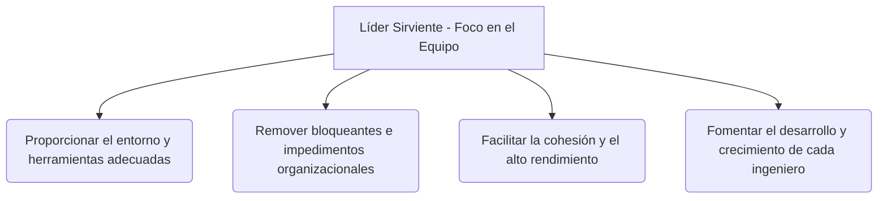

# Gestión de Recursos y Liderazgo de Equipos en Proyectos Ágiles

> [!NOTE]
> **Enfoque de Ingeniería y Liderazgo Técnico (Big Tech Mindset)**  
> En Big Tech, el antipatrón más costoso es el fraccionamiento de tiempo de los ingenieros en múltiples proyectos paralelos (*context switching*). Un líder técnico efectivo defiende la dedicación exclusiva de las células de desarrollo, fomenta la autoorganización y actúa como un facilitador que elimina los obstáculos del camino del equipo (*servant leadership*).

---

## Equipos Multifuncionales y Dedicados vs. Fraccionados (Time-Fractioned)

La asignación de ingenieros a múltiples proyectos simultáneos degrada la productividad neta debido al costo cognitivo del cambio de contexto (*context switching*).

```text
  TRADICIONAL (Fraccionado):
  Ingeniero A ──> 30% Proyecto 1  ──> 40% Proyecto 2  ──> 30% Soporte Legacy
  * Alto desperdicio de tiempo por cambio de contexto y reuniones duplicadas.

  ÁGIL (Equipo Multifuncional y Dedicado):
  [Célula / Pod Dedicado] ──> Foco del 100% en un único Producto/Backlog
  (Incluye Backend, Frontend, QA, Diseñador y Product Owner integrados)
```

### Características de las Células de Desarrollo Ágiles (Pods)
* **Multifuncionalidad (Cross-functionality):** El equipo tiene todas las habilidades necesarias para llevar una idea desde el concepto hasta el despliegue en producción (código funcionando) sin depender de aprobaciones de equipos externos.
* **Autoorganización:** El equipo es autónomo y responsable de decidir **cómo** resolver los problemas técnicos y estimar su propia capacidad de trabajo.
* **Co-localización:** Fomentar el trabajo en el mismo espacio (físico o virtual mediante canales de comunicación inmediata) para maximizar la transferencia de conocimiento tácito.

---

## El Rol del Project Manager / Tech Lead como Líder Sirviente

En Agile, el líder abandona el rol clásico de comando y control (asignación y supervisión directa de tareas) y asume la filosofía de **Líder Sirviente (Servant Leader)**:



---

## Grupo vs. Equipo

Lo que distingue a un equipo de un grupo es su grado de **interdependencia y cohesión**. Un equipo:

* Comparte una misión, metas y expectativas.
* Distribuye el trabajo según habilidades y competencias.
* Comparte la responsabilidad sobre los resultados.
* Se comunica de forma horizontal, se autoorganiza y resuelve sus propios problemas.
* Mantiene la continuidad de sus miembros como un activo para asegurar resultados.

### Gestión Centralizada vs. Distribuida (PMBOK 7)

| | Gestión centralizada | Gestión distribuida |
| :--- | :--- | :--- |
| **Rendición de cuentas** | Recae en una persona (jefe de proyecto o rol similar). | Compartida por el equipo. |
| **Liderazgo** | Autoridad designada. | Un facilitador habilita la comunicación y la colaboración; el rol puede rotar entre miembros. |
| **Estilo asociado** | Dirección y control. | Liderazgo de servicio. |

Preguntas con las que un líder de servicio evalúa su propio trabajo: ¿están creciendo los miembros del equipo como individuos?, ¿son más saludables, sabios, libres y autónomos?, ¿es probable que ellos mismos se conviertan en líderes de servicio?

---

## Bases Comunes del Desarrollo de Equipos

1. **Visión y objetivos:** todos conocen la visión, y esta se usa como referencia al tomar decisiones y resolver problemas.
2. **Roles y responsabilidades:** cada miembro entiende su función; se identifican y cierran brechas de conocimiento y habilidades.
3. **Operaciones del equipo:** un **acta del equipo** (*team charter*) y normas de trabajo facilitan la comunicación, la resolución de problemas y el consenso.
4. **Orientación:** mantener a todos en la dirección correcta; también los miembros se orientan entre sí.
5. **Crecimiento:** señalar qué funciona bien y qué puede mejorar, y fijar objetivos de mejora en conjunto.

La cultura del equipo se establece deliberadamente (normas) o informalmente (comportamientos), y opera dentro de la cultura de la organización.

### Objetivos SMART

| Letra | Criterio | Pregunta |
| :---: | :--- | :--- |
| **S** | Específico | ¿Qué quiero lograr, para quién y dónde? |
| **M** | Medible | ¿Cómo sabré que se cumplió? |
| **A** | Alcanzable | ¿Es realista considerando las limitaciones? |
| **R** | Relevante | ¿Por qué es importante ahora? |
| **T** | Temporal | ¿En cuánto tiempo? |

*Ejemplo:* "Tener un prototipo navegable de la app validado con 5 vecinos y 2 recicladores para la semana 8."

### Plantilla de Acta del Equipo

| Elemento | Contenido |
| :--- | :--- |
| **Misión** | Propósito del equipo y del proyecto. |
| **Roles** | Product Owner, Scrum Master, desarrolladores, etc. |
| **Objetivo SMART** | Meta principal del proyecto. |
| **Autoevaluación (1–5)** | Confianza, comunicación abierta y compromiso. |
| **Fortalezas y riesgos** | Ej. *F:* el equipo ya se conoce. *R:* nadie tiene experiencia en UX. |

Un equipo que se autoevalúa bajo pero con honestidad está mejor que uno que finge estar bien.

---

## Equipos de Alto Rendimiento

**Factores que los sostienen:** entendimiento y propiedad compartidos, complementariedad, coordinación, comunicación abierta, confianza, compromiso, adaptabilidad, reconocimiento y empoderamiento. En los estudios de productividad de equipos ágiles, la capacidad de las personas y la cohesión del equipo pesan más que la simplicidad técnica o la experiencia previa.

### Las 5 Disfunciones de un Equipo (Lencioni)

Cada disfunción se apoya en la anterior; la base de todas es la falta de confianza.

```text
            /   Desatención a los resultados   \
           /     Falta de responsabilidad       \
          /        Falta de compromiso           \
         /         Miedo al conflicto             \
        /          Falta de confianza              \
```

### Habilidades de Liderazgo para Todo el Equipo

Son útiles para todos los miembros, exista o no una autoridad centralizada.

* **Escucha activa:** escuchar con mentalidad abierta y hasta que el otro termine, atender a cómo se dicen las cosas, respetar las pausas y dar feedback.
* **Pensamiento crítico:** cuestionar propósitos, datos, supuestos, inferencias, conceptos, consecuencias y puntos de vista; reconocer sesgos y buscar la causa raíz.
* **Motivación:** primero entender qué motiva a cada persona y luego trabajar para sostener su compromiso. Predominan los motivadores intrínsecos: logro, desafío, creencia en el trabajo, autonomía, responsabilidad, crecimiento y pertenencia.

### Verificación: ¿Ya Tengo un Equipo?

| Resultado esperado | Cómo comprobarlo |
| :--- | :--- |
| **Propiedad compartida** | Todos conocen la visión y los objetivos; el equipo se siente dueño de los entregables y resultados. |
| **Alto rendimiento** | Hay confianza y colaboración; el equipo se adapta, es resiliente y reconoce a sus miembros. |
| **Liderazgo y habilidades interpersonales** | Todos aplican pensamiento crítico; los estilos de liderazgo se ajustan al contexto. |

---

## Los 5 Valores de Scrum

Los marcos de trabajo ágiles se sostienen sobre valores culturales que guían el comportamiento colectivo:

1. **Compromiso (Commitment):** El equipo se compromete a alcanzar las metas del Sprint y a apoyarse mutuamente en el proceso.
2. **Coraje (Courage):** Tener la valentía de hacer lo correcto, afrontar problemas técnicos complejos y decir "no" cuando los requerimientos comprometen la calidad.
3. **Enfoque (Focus):** Concentrarse en el trabajo del Sprint y limitar el WIP para entregar valor real de forma fluida.
4. **Apertura (Openness):** Transparencia total sobre el estado del proyecto, los riesgos y los fallos cometidos para aprender colectivamente.
5. **Respeto (Respect):** Valorar la capacidad y la autonomía de cada miembro del equipo, reconociendo que cada uno aporta desde su experiencia multifuncional.

---

> [!TIP]
> **Pregunta de Entrevista de Big Tech (Technical Leadership & People Management)**  
> *Tenemos un Tech Lead muy talentoso que escribe el 50% de las características del Sprint, pero toma todas las decisiones de arquitectura de manera unilateral, asigna las tareas directamente a los ingenieros junior y no fomenta el debate técnico en las dailies. ¿Cómo abordarías esta situación como Engineering Manager?*
> 
> **Respuesta Estratégica:**  
> 1. **Identificar el Antipatrón (El "Héroe" o Silo de Conocimiento):** Reconozco que, aunque el Tech Lead produce mucho código, su estilo de liderazgo está sofocando la autoorganización del equipo, creando dependencias críticas en su persona y bloqueando el desarrollo de los ingenieros junior.
> 2. **Conversación 1-on-1 de Feedback:** Me reúno con el Tech Lead para cambiar su perspectiva sobre el éxito:
>    * Su métrica de éxito ya no es cuánto código escribe individualmente (*output*), sino **el impacto y el crecimiento técnico del equipo a su cargo** (*outcome*).
>    * Le propongo actuar como un líder sirviente y mentor.
> 3. **Acciones Concretas para Fomentar la Autoorganización:**
>    * *Pair Programming* obligatorio del Tech Lead con los juniors en los componentes más complejos para transferir el conocimiento tácito.
>    * Delegar el diseño de pequeñas arquitecturas a los juniors, actuando el Tech Lead únicamente como revisor (*facilitador*).
>    * Fomentar que en las reuniones de planificación y Daily el equipo decida la asignación de tareas de forma colectiva y visual en el tablero Kanban.
